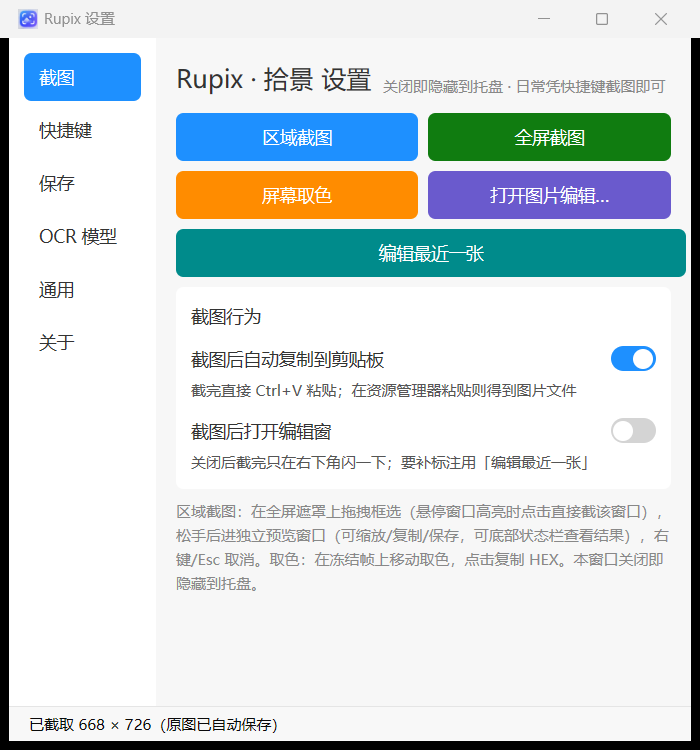
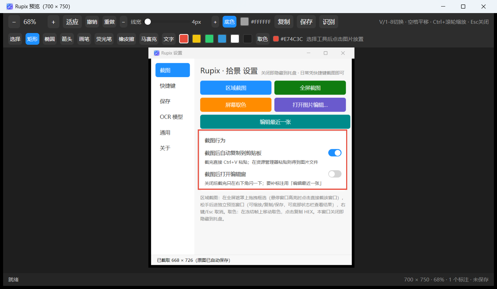
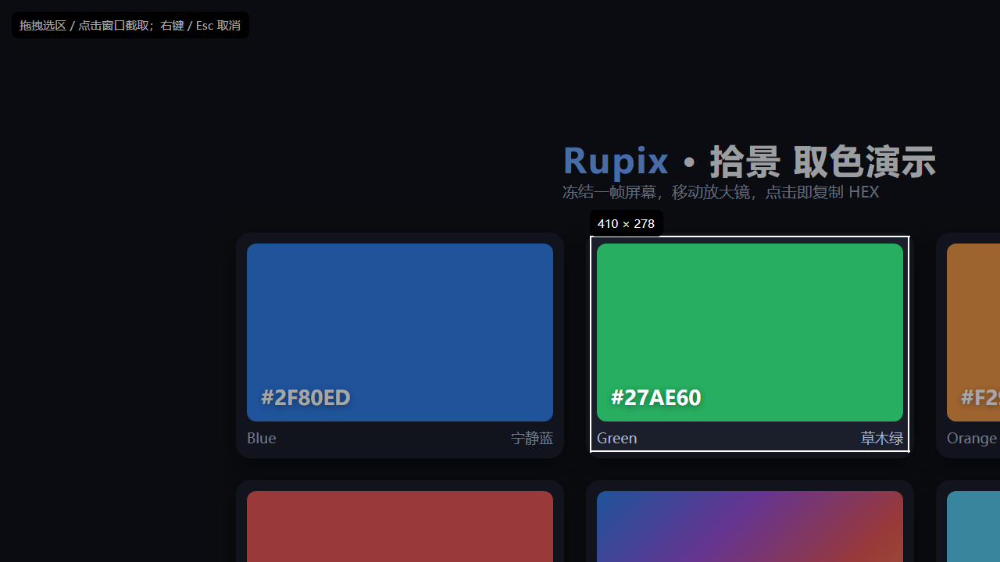
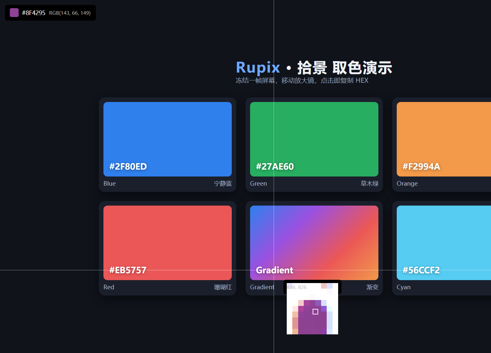

# Rupix · 拾景


**看到 → 截取 → 留存。** 一款用 Rust + rgpui 写的轻量级跨平台截图工具：
托盘常驻、全局热键、截完即存即复制，需要时再标注、取色或离线识别文字。

[](https://github.com/launcher-rs/rupix/actions/workflows/ci.yml)
[](https://github.com/launcher-rs/rupix/releases)
[](LICENSE-APACHE)


## 核心特点

- **截完直接能粘**：热键 → 自动存新文件 → 自动进剪贴板，焦点不离开当前程序，`Ctrl + V` 即可；
- **标注可改、文字可用**：矢量标注随时撤销重做；离线 OCR 结果能复制，也能落回图里成为文字标注；
- **顺手且可脚本化**：托盘常驻、取色即复制 HEX，`rupix -f` / `-r x,y,w,h` 可被脚本直接调用；
- **Rust 原生、单文件便携**：没有 Electron / WebView，配置就在 exe 旁边，解压即用；
  Windows / Linux / macOS 同一套交互。

## 界面截图

| 设置页（截图入口 + 行为开关） | 标注编辑（矢量标注 + 撤销重做） |
| --- | --- |
|  |  |

| 区域截图（冻结帧框选 + 尺寸徽标） | 屏幕取色（放大镜 + HEX） |
| --- | --- |
|  |  |

## 功能特性

- **区域截图**：全屏冻结帧上拖拽框选，实时尺寸徽标，右键 / `Esc` 取消；
  未拖拽时悬停高亮窗口，点一下即截该窗口（窗口截图并入区域模式，不再单独占一个热键）
- **全屏截图**：一键截取主显示器并进入统一收尾流程
- **屏幕取色**：冻结帧 + 放大镜 + 十字线，点击复制 HEX
- **预览与标注**：缩放 / 平移、矩形、椭圆、箭头、画笔、荧光笔、橡皮擦、马赛克、文字，
  撤销重做、颜色与线宽可调，底部状态栏给出保存结果
- **自动保存**：默认存到系统图片库的 `rupix` 子目录，文件名带毫秒时间戳，永不覆盖原图
- **双格式复制**：文档里粘成图片，资源管理器里粘成文件（Windows）
- **截图行为开关**：截图后自动复制（默认开）、截图后打开编辑窗（默认关，改在设置 → 截图）；
  不弹窗时右下角闪一枚提示胶囊，不抢焦点、不会出现在下一张截图里
- **编辑最近一张**：设置页与托盘各一个入口，补标注不用再走文件对话框
- **本地图片编辑**：托盘 / 设置页打开任意图片做标注，另存新文件
- **全局热键**：区域 / 全屏 / 取色三个，失焦可用，设置页可录制
- **托盘常驻**：启动即隐藏到托盘，左键打开设置，右键出菜单
- **命令行截图**：`-f` 全屏 / `-r x,y,w,h` 区域，直存 PNG，可 `--copy`
- **离线 OCR**：PP-OCRv5 mobile（MNN），中英文及多个小语种家族，后台识别不卡界面
- **开机启动**：Windows 注册表 `Run`、macOS LaunchAgents、Linux XDG autostart，只写当前用户范围
- **中英双语**：内置中文 / English，可放 `lang-<代码>.txt` 扩展其他语言

## 下载与安装

到 [Releases](https://github.com/launcher-rs/rupix/releases) 下载对应平台的两个包之一：

| 包 | 适合谁 | 内容 |
| --- | --- | --- |
| `rupix-<平台>.zip` / `.tar.gz` | 想自己换 OCR 模型 / 在意体积 | 可执行文件 + 外置 `models/`（OCR 开箱即用） |
| `rupix-<平台>-bundled.zip` / `.tar.gz` | 想要单文件、拷到哪都能跑 | 可执行文件，OCR 模型已打进二进制（约 +21MB） |

- Windows 为 x86_64、使用静态 CRT（免装 MSVC 运行库）；macOS 为 Apple Silicon 构建；
  Linux 为 x86_64、glibc ≥ 2.35（Ubuntu 22.04+ / Debian 12+ / Fedora 35+）。
- 绿色便携：解压即用，无需安装器；配置写在 exe 同目录，删掉程序目录即可卸载。
- 开机启动默认关闭，可在设置 → 通用里打开。

> Windows 首次运行时 SmartScreen 可能提示「未知发布者」，这是未做代码签名的小项目常态，
> 可选择「更多信息 → 仍要运行」，或用源码自行构建。

## 使用

### 全局热键（可在设置 → 快捷键里改）

| 默认按键 | 功能 |
| --- | --- |
| `Ctrl + Shift + A` | 区域截图；悬停高亮窗口时点击即截该窗口 |
| `Ctrl + Shift + F` | 全屏截图 |
| `Ctrl + Shift + P` | 屏幕取色 |

### 默认流程

1. 启动后程序隐藏到系统托盘（双击 exe 不会弹窗，左键单击托盘图标打开设置）；
2. 按热键截图，区域模式拖拽框选，松手即完成；
3. 图片自动保存到 **图片库 / rupix**（Windows 为 `%USERPROFILE%\Pictures\rupix`，
   OneDrive 接管图片库时为 `%OneDrive%\Pictures\rupix`），同时按设置复制到剪贴板；
4. 默认不弹编辑窗，只在右下角闪一下保存提示。需要标注时：
   - 在 设置 → 截图 打开「截图后打开编辑窗」，或
   - 从 托盘 / 设置页 点「编辑最近一张」，或
   - 直接打开任意图片（托盘 → 打开图片编辑）。

### 设置页

| Tab | 内容 |
| --- | --- |
| 截图 | 区域 / 全屏 / 取色入口、编辑最近一张、两个截图行为开关 |
| 快捷键 | 区域 / 全屏 / 取色热键录制，改完立即生效 |
| 保存 | 默认保存目录、最近保存记录（可直接打开文件 / 目录） |
| OCR 模型 | 当前生效模型、三个模型文件的手动指定、下载指引 |
| 通用 | 界面语言、开机启动 |
| 关于 | 版本、简介、仓库地址 |

全部设置集中在 exe 旁边的 `rupix-config.json`（纯文本，可直接编辑）。

## 命令行截图

不带参数启动图形界面；带截图参数时不进界面，截完直接退出，可与托盘进程并存，适合脚本调用。

```bash
rupix -f                              # 全屏截图，保存到默认目录
rupix -f -o D:\shot.png               # 全屏截图，保存到指定文件
rupix -r 100,200,800,600 -o a.png     # 区域截图（虚拟屏幕物理像素）
rupix -f --copy                       # 保存后再把文件复制到剪贴板（Windows）
rupix --help                          # 查看全部参数
rupix --version                       # 显示版本
```

| 参数 | 说明 |
| --- | --- |
| `-f` / `--fullscreen` | 截取全屏（多显示器取并集） |
| `-r` / `--region x,y,w,h` | 截取指定区域，与 `-f` 互斥；部分越界按交集裁剪 |
| `-o` / `--output 路径` | 输出文件或已存在目录；无扩展名补 `.png`；缺省用默认保存目录 |
| `--copy` | 保存后把文件复制到剪贴板（Windows） |
| `-h` / `--help`、`-V` / `--version` | 帮助 / 版本 |

退出码：`0` 成功，`1` 参数错误，`2` 截图 / 保存失败。成功时打印 `已保存：<路径>`。
命令行截图目前仅 Windows 支持（GDI `BitBlt`），非 Windows 会返回明确错误。

## OCR 文字识别

预览窗点「识别」，后台线程离线推理（单张大图约 0.6 秒，前台不卡）：

- 结果进右侧面板：点行可定位高亮并复制该行，也可一键复制全部；
- 点「落为标注」把识别行转成文字标注，之后可像普通标注一样移动 / 删除；
- 低置信度行与单字误检会自动过滤。

模型来源按优先级：

1. 设置 → OCR 模型里手动指定的检测 / 识别 / 字典三个文件（文件名不做匹配）；
2. `RUPIX_OCR_MODELS` 环境变量指向的目录；
3. exe 旁的 `models/`（常规发行包自带；开发期由 `build.rs` 从 `assets/ocr-models/` 同步）；
4. 当前工作目录的 `models/`；调试构建再回退到包根 `assets/ocr-models/`。

默认三件套约 21MB，已随仓库提供。需要换模型或补小语种时，用
`scripts/download-ocr-models.ps1` 从官方模型库下载；设置页里也有下载地址与复制按钮。

## 从源码构建

环境要求：

- Rust stable（`edition = "2024"`，建议最新稳定版）；
- LLVM / libclang（`ocr-rs` 经 bindgen 绑定 MNN，构建时需要）；
- Windows：MSVC 工具链，`.cargo/config.toml` 已配置静态 CRT；
- Linux：`libclang-dev libwayland-dev libxkbcommon-dev libxkbcommon-x11-dev libx11-dev
  libx11-xcb-dev libxcb1-dev libasound2-dev libudev-dev`。

```bash
cargo build --release            # 日常使用 / 正式发版（opt-level=3 + thin LTO + strip）
cargo build --profile size       # 打发布包（opt-level=z + fat LTO，体积最小）
cargo run --features bundled-ocr-models   # 体验单文件内嵌 OCR 的形态
```

说明：

- **不要用 `cargo run` 日常截图**：debug 构建没有优化，4K 冻结帧的推流、解码、裁剪与烧录
  会慢一到两个数量级，拖拽和取色都会掉帧；只用它验证逻辑，体验请用 release 构建。
- 提交前确保 `cargo fmt --check`、`cargo clippy -- -D warnings`、`cargo test` 通过。
- 在 PowerShell 7 下构建若遇到 ocr-rs 解压失败，换 cmd / Windows PowerShell 5.1，
  或预置 `%USERPROFILE%\.cargo\registry\src\<镜像>\ocr-rs-<版本>\3rd_party\prebuilt\...` 缓存
  （详见仓库 Issue 与 `ocr-rs` 构建脚本）。
- 维护者的 CI 与发版流程见 [docs/RELEASING.md](docs/RELEASING.md)。

## 项目结构

```text
rupix/
├── assets/                 图标、托盘图标、OCR 默认模型、README 截图
├── build.rs                Windows exe 图标嵌入 + OCR 模型分发到输出目录
├── scripts/                OCR 模型下载脚本
├── docs/                   RELEASING（发版 / CI）、ROADMAP（路线图）
├── src/
│   ├── main.rs             程序入口：CLI 早分发、单例、托盘、全局热键
│   ├── app.rs              设置窗口：截图入口、行为开关、热键、保存、OCR、通用、关于
│   ├── capture.rs          首帧捕获（推流取帧）与截图后统一收尾
│   ├── overlay.rs          区域选择浮层（含窗口吸附）
│   ├── picker.rs           屏幕取色浮层
│   ├── viewer.rs           预览与标注窗口（含 OCR 面板）
│   ├── export.rs           标注烧录、保存、双格式复制、跨平台字体加载
│   ├── shapes.rs           矢量标注模型与颜色预设
│   ├── toast.rs            右下角保存提示胶囊
│   ├── window.rs           顶层窗口枚举 / 命中（Windows）与自身窗口排除抓屏
│   ├── hotkey.rs           全局热键注册与持久化
│   ├── tray.rs             托盘常驻与菜单
│   ├── cli.rs              命令行截图
│   ├── ocr.rs              离线 OCR 与模型查找
│   ├── autostart.rs        开机启动（三平台）
│   └── i18n.rs             中英双语与外部语言文件
├── Cargo.toml
├── CHANGELOG.md
├── AGENTS.md               协作与代码规范
└── LICENSE-APACHE
```

技术栈：Rust + [rgpui](https://crates.io/crates/rgpui)（UI / 窗口）+
`image`（编解码 / 裁剪）、`ab_glyph`（文字烧录）、`ocr-rs`（MNN 离线 OCR）。

## 常见问题

**双击 exe 没反应？**
程序启动后驻留托盘，不弹主窗口。左键单击托盘图标打开设置；已有实例在跑时再次双击会直接退出
（单实例守卫，避免热键冲突和重复托盘图标）。

**截图存到哪了？**
默认是图片库下的 `rupix` 子目录，可在 设置 → 保存 修改。每张都是新文件，不会覆盖之前的截图；
「最近保存」里能直接打开文件或目录。

**为什么默认不弹编辑窗？**
多数截图只需要「截下来 + 粘贴」。默认路径做到最短：自动保存 + 自动复制 + 角落提示。
需要标注时，在设置里打开「截图后打开编辑窗」，或随时用「编辑最近一张」补。

**OCR 提示找不到模型？**
常规包里模型在 exe 旁的 `models/`；确认解压完整，或用内嵌版（`-bundled`）。
也可以从设置 → OCR 模型手动指定三个文件。自行构建时需要 LLVM / libclang。

**支持多显示器吗？**
区域截图 / 取色目前覆盖主显示器（冻结帧只取主屏）；命令行 `-f` 会截取虚拟桌面并集，
`-r` 的坐标也按虚拟屏幕物理像素计算。多屏区域截图记录在 [docs/ROADMAP.md](docs/ROADMAP.md)。

**Linux / macOS 能用吗？**
代码与 CI 覆盖三平台，Windows / Linux 已在真机上验证可用，macOS 尚未完整回归，
欢迎反馈 Issue / PR。

## 贡献

欢迎 Issue 与 PR。提交代码前请阅读 [AGENTS.md](AGENTS.md)：本项目要求
**所有新增与修改的 Rust 代码必须有简体中文注释**，并通过 `cargo fmt --check` 与
`cargo clippy -- -D warnings`。提交信息用中文 `<类型>: <简述>`。

## 许可证

[Apache-2.0](LICENSE-APACHE)。
