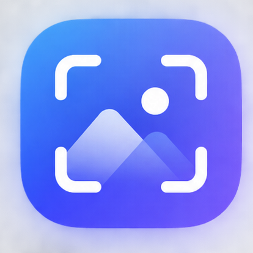

# Rupix · 拾景



> **Rupix（拾景）是一款基于 Rust 与 rgpui 构建的轻量级跨平台截图工具，用于快速拾取并保存屏幕上的精彩瞬间。**
>
> **Rupix — A lightweight screenshot tool built with Rust and rgpui.**

## 名字含义

**拾景 = 拾取 + 景象**

- **拾**：拾取、收集、留存。从屏幕中拾取一个瞬间。
- **景**：景象、画面、所见之景。屏幕上的画面、窗口、区域、一瞬间的视觉内容。

> **以像素承载画面，以拾取留住所见。**
>
> **看到 → 截取 → 留存**

## 功能特性

- [x] 区域截图（全屏冻结帧上拖拽框选，尺寸徽标，右键 / Esc 取消）
- [x] 全屏截图（截取即进预览）
- [x] 窗口截图（悬停高亮顶层窗口，点击截取，Windows）
- [x] 屏幕取色（冻结帧 + 放大镜 + 十字线，点击复制 HEX）
- [x] 预览与标注（缩放 / 平移 / 矩形 / 椭圆 / 箭头 / 画笔 / 荧光笔 / 橡皮擦 / 马赛克 / 文字 / 撤销重做 / 颜色 / 线宽，底部状态栏显示结果）
- [x] 保存（桌面时间戳新文件，状态栏可直接打开文件 / 目录，从不覆盖原图）
- [x] 双格式复制（Word / 画图粘贴为图片，资源管理器粘贴为文件）
- [x] 本地图片编辑（托盘 / 设置页打开任意图片做标注，另存新文件）
- [x] 双全局热键扩展为四热键（区域 / 全屏 / 取色 / 窗口各一个，设置页录制，失焦可用，默认 `Ctrl+Shift+A` / `Ctrl+Shift+F` / `Ctrl+Shift+P` / `Ctrl+Shift+W`）
- [x] 托盘常驻（启动即隐藏到托盘：区域截图 / 全屏截图 / 屏幕取色 / 窗口截图 / 打开图片编辑 / 打开设置 / 退出）
- [x] 命令行截图（`rupix -f` 全屏 / `rupix -r x,y,w,h` 区域，直存 PNG，可 `--copy` 进剪贴板）
- [ ] OCR 文字识别

## 技术栈

```text
Rust + rgpui + rgpui-platform
```

| 依赖              | 用途                          |
| ----------------- | ----------------------------- |
| `rgpui`           | UI 渲染与交互框架             |
| `rgpui-platform`  | 跨平台窗口 / 事件支持         |
| `image`           | 图片编解码、裁剪与导出        |
| `ab_glyph`        | 文字标注的字形光栅化          |
| `windows`         | Windows 双格式剪贴板（图片+文件） |
| `embed-resource`  | Windows exe 图标嵌入（构建依赖） |

Rust 版本要求：见 `Cargo.toml` 中 `edition = "2024"`，建议使用最新 stable 工具链。

## 项目结构

```text
rupix/
├── assets/              应用图标与托盘图标（logo.png / app.ico / tray.png）
├── build.rs             Windows exe 图标嵌入
├── src/
│   ├── main.rs          程序入口（设置窗口默认隐藏到托盘）
│   ├── app.rs           设置窗口：热键录制、截图入口、保存历史
│   ├── capture.rs       截图核心（推流取首帧）
│   ├── overlay.rs       区域选择浮层与窗口拾取浮层（冻结帧 + 拖拽框选 / 悬停高亮）
│   ├── picker.rs        屏幕取色浮层（放大镜 + 十字线，点击复制 HEX）
│   ├── window.rs        顶层窗口枚举与命中（Windows；其他平台返回空）
│   ├── viewer.rs        预览与标注窗口（含底部状态栏）
│   ├── export.rs        标注烧录、保存、双格式复制
│   ├── shapes.rs        矢量标注模型
│   ├── hotkey.rs        全局热键注册与持久化
│   ├── cli.rs           命令行截图（全屏 / 区域直存 PNG，不进图形界面）
│   └── tray.rs          托盘常驻与菜单
├── Cargo.toml           包配置与依赖（含 release 优化）
├── README.md            项目说明（本文件）
└── AGENTS.md            AI 协作与代码规范说明
```

## 快速开始

```bash
# rupix 目录下执行
cargo run              # 本地运行（启动即隐藏到托盘，用快捷键截图）

# 命令行截图（不启动图形界面，可与托盘进程并存）
cargo run -- -f                          # 全屏截图，自动保存到默认目录
cargo run -- -f -o D:\shot.png           # 全屏截图，保存到指定文件
cargo run -- -r 100,200,800,600 -o a.png # 区域截图（虚拟屏幕物理像素）
cargo run -- --help                      # 查看全部参数

# 构建 release（已配 opt-level=3 / LTO / strip）
cargo build --release

# 代码检查（提交前必须通过）
cargo fmt --check
cargo clippy -- -D warnings
cargo test
```

## 命令行截图

不带参数启动图形界面（托盘常驻）；带截图参数时不启动界面，直接截图后退出，可与托盘进程并存，适合脚本调用。

```bash
rupix -f                              # 全屏截图，自动保存到默认目录
rupix -f -o D:\shot.png               # 全屏截图，保存到指定文件
rupix -r 100,200,800,600 -o a.png     # 区域截图（虚拟屏幕物理像素）
rupix -f --copy                       # 保存后再复制文件到剪贴板（Windows）
rupix --help                          # 查看全部参数
rupix --version                       # 显示版本
```

| 参数 | 说明 |
| ---- | ---- |
| `-f` / `--fullscreen` | 截取全屏（多显示器取并集） |
| `-r` / `--region x,y,w,h` | 截取指定区域，如 `100,200,800,600`；与全屏互斥 |
| `-o` / `--output 路径` | 输出文件或已存在目录（目录则自动补时间戳文件名）；无扩展名时补 `.png`；缺省为图形界面共用的默认目录（`图片库/rupix/rupix-<毫秒>.png`） |
| `--copy` | 保存后把文件再复制到剪贴板（Windows） |
| `-h` / `--help`、`-V` / `--version` | 帮助 / 版本 |

说明：

- 坐标为虚拟屏幕物理像素：多显示器取并集，主屏左上角不一定是 `(0,0)`；区域部分越界按交集裁剪，完全无交集报错。
- 退出码：`0` 成功，`1` 参数错误，`2` 截图 / 保存失败；成功时打印 `已保存：<路径>`。
- Windows 实现为 GDI 同步截屏（`BitBlt`），与其他截图软件的捕获会话不冲突；非 Windows 平台暂不支持。
- release 包无控制台窗口，从终端启动时会自动挂接父控制台输出结果。

## 贡献

欢迎提交 Issue 与 PR。提交代码前请阅读 `AGENTS.md`，特别注意：**所有新增与修改的 Rust 代码必须添加中文注释**。

## License

Apache-2.0，见 `LICENSE-APACHE`。
